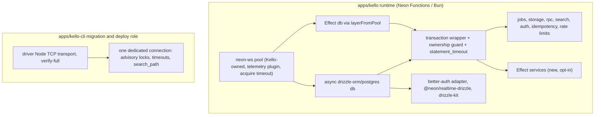
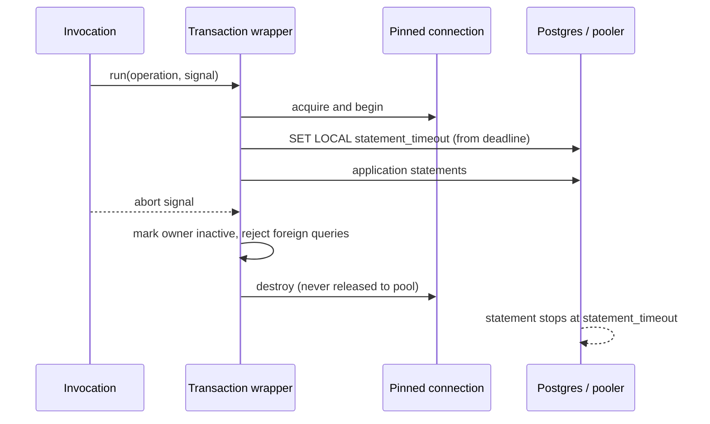

# Drizzle rc.6 and Neon WebSocket Driver - Plan

## Goal Capsule

- **Objective:** Kello applications serve more requests per second on Neon and can use the database natively from Effect. Transactions, job leases, migration locks and TLS checks keep their guarantees, and an aborted statement stops within a bounded time.
- **Means:** Upgrade to Drizzle `1.0.0-rc.6`, then move the runtime onto Drizzle's bundled Postgres driver over Neon WebSocket (KTD1, KTD2). Move the migration role onto the same driver's TCP transport last (KTD6).
- **Authority:** On product behaviour, the Product Contract requirements win over this Planning Contract. On mechanism, KTDs win over unit Approach text. Where the code and these documents disagree, `AGENTS.md` and `patches/README.md` govern repository conventions.
- **Stop conditions:** Stop and report instead of working around it in any of these cases:
  - A unit cannot meet R6–R9 on the new driver.
  - A Drizzle issue listed under Risks reproduces in Kello's suites.
  - The Neon pre-commit hook cannot run.
  - The Neon Functions isolate lacks a global `WebSocket` or `node:stream`.
  - The U6 throughput spot-check shows neon-ws serving fewer requests per second than `main`.
- **Execution profile:** One PR from branch `feat/drizzle-rc6-neon-ws`. It already carries the `@neon/config` 1.14.6, `neon` 9.9.3 and `vite-plus` 1.7.0 upgrades, uncommitted. Commit each unit separately, and only after its verification passes. Every commit goes through the Neon pre-commit hook. The hook needs an expiring `kello-acceptance-*` branch made from `main`, `KELLO_CLOUD_BRANCH_ID`, and the user's Neon CLI login. Never bypass it.
- **Finisher:** `ce-work` implements, runs the gates and requests reviews: code, implementation and security, on gpt-6-astra at low effort. The user supplies the Neon login and merges.

---

## Product Contract

### Summary

Kello moves from Drizzle rc.5 with `pg`/`node-postgres` to Drizzle rc.6 and the driver now bundled in `drizzle-orm`. The runtime connects over Neon WebSocket and exposes both a Promise database and an Effect database. The CLI's migration and deploy role uses the same driver's TCP transport on one dedicated session. `pg` and `@types/pg` leave the dependency tree.

### Problem Frame

Drizzle's own benchmark has the same application code serving 1.2–1.5× more requests per second on the bundled driver than on `node-postgres`. On the bundled driver, every transport returns identical values for bigints, arrays, JSON and microsecond timestamps. Kello currently pays for `pg` in three places:
- Two patches compensate for its encoding and introspection gaps.
- `cancel.ts` reaches into undocumented `pg` internals.
- Effect only carries the database as an opaque value.

rc.6 also breaks two things Kello depends on:
- drizzle-kit is now ESM only, so the `inspectSchema` patch no longer applies.
- Snapshot format 10 drops index `concurrently`.

Staying on rc.5 means carrying those patches against a release line upstream has moved past.

### Key Decisions

- **Neon WebSocket for the runtime, Neon HTTP only for stateless reads and atomic batches.** rc.6's HTTP session throws on interactive transactions. Governs R5, R6. (session-settled: user-approved — chosen over Neon HTTP as the runtime driver: HTTP cannot hold the open transactions that function invocations and job claims need)
- **Upgrade `effect` to 4.1.5.** Governs R4. (session-settled: user-directed — chosen over staying on 4.1.2: the Effect drivers need 4.1.3 or later)
- **The dependency upgrades already on the branch ship in this PR.** Governs R1. (session-settled: user-directed — chosen over a separate dependency branch)
- **Realtime stays on `pg_notify` plus Neon Realtime; drizzle-pulse is evaluated later.** Governs R10. (session-settled: user-approved — chosen over adopting drizzle-pulse now: it needs logical replication and a slot per Neon branch, which changes the branch lifecycle)

### Requirements

**Dependencies and toolchain**
- R1. The branch's `@neon/config` 1.14.6 (with the ported bucket-privacy patch), `@neon/config-runtime` 1.12.9, `neon` 9.9.3 and `vite-plus` 1.7.0 upgrades land with all gates green, except `@kello/example-next#build`, which also fails on `main`.
- R2. `drizzle-orm` and `drizzle-kit` are `1.0.0-rc.6` in every workspace manifest. No workspace resolves an older drizzle-kit.
- R3. Migration planning keeps working on rc.6:
  - Schema inspection is still available.
  - Snapshot format 10 is accepted.
  - Every committed example plan and its hash stays byte-identical.
- R4. `effect` is 4.1.5 everywhere, and the Effect drivers type-check against it.

**Runtime driver**
- R5. The runtime connects through Drizzle's bundled driver over Neon WebSocket. Application code gets a Promise database and an Effect database over one shared pool.
- R6. Function transactions keep their isolation and access modes:
  - Repeatable-read, read-only for queries.
  - Serializable for mutations.
  - Retry on serialization failure and deadlock.
  - Ownership rejection of queries from another or finished invocation.
- R7. Aborting an invocation never leaves its statement running past a bounded time. The connection that ran it is never reused afterwards.
- R8. Durable jobs, crons, storage cleanup and durable events keep their claim-then-lease semantics under `FOR UPDATE SKIP LOCKED`, with values decoded the same as before.
- R9. Connections verify the server certificate and hostname. Neon `-pooler` hosts are rejected wherever a dedicated session is required.
- R10. Realtime revision notification, better-auth persistence and `@neon/realtime-drizzle` keep working on the new driver.

**Migration role**
- R11. Migrations and deploys hold session advisory locks on one dedicated, unpooled session, with the current timeouts and `search_path`.
- R12. `pg` and `@types/pg` are removed from every workspace. Kello's published types no longer reference `pg` or `node-postgres`.

### Success Criteria

- Unit, integration, packed-consumer and Neon pre-commit gates all pass.
- An HTTP throughput run of an example app on the new driver serves at least as many requests per second as the same run on `main`.

### Scope Boundaries

- Not in scope: rewriting Kello's service layer to Effect-native queries. The Effect database becomes available, but existing Promise call sites move only where a unit says so.
- Not in scope: Neon HTTP as a second runtime path, beyond the read/batch use KTD2 allows.
- Considered and not built: a CancelRequest over WebSocket. rc.6's neon-ws transport has none. KTD4 bounds runaway statements instead. An upstream cancel path would change this call.

#### Deferred to Follow-Up Work

- drizzle-pulse as a replacement for `pg_notify` and Neon Realtime.
- Moving existing Promise service code to Effect-native queries once Drizzle issues #6716 (interrupt does not cancel) and #6717 (Effect transactions always `begin read write`) are fixed.
- Remaining low-risk dependency bumps from the findings report (`docs` and example patch bumps).

### Open Questions

- Deferred: does the Neon Functions isolate expose a global `WebSocket` and `node:stream`? The research found no evidence either way. U6 proves it in the cloud smoke. If it fails, that is a stop condition, and the transport choice goes back to the user.
- Deferred: is the runtime `DATABASE_URL` a pooled (`-pooler`) host in deployed environments? U7's statement bound covers both cases. Record what the cloud smoke observes.

### Sources

- Findings report: `plans/drizzle-rc6-findings.md` (untracked working notes).
- Drizzle rc.6 release notes: https://orm.drizzle.team/docs/latest-releases/drizzle-orm-v1rc6
- Drizzle launch thread with benchmarks: https://x.com/DrizzleORM/status/2123860481324552366
- Drizzle issues #6708, #6713, #6715, #6716, #6717 (github.com/drizzle-team/drizzle-orm).
- Package evidence (rc.6 tarball):
  - `postgres/neon-http/session.js` (transaction throws).
  - `postgres/client/dist/neon-ws.js` (no cancel transport, protocol TLS off).
  - `postgres/client/dist/transport-node.js` (verify-full and CancelRequest).
  - `postgres/client/dist/effect/DrizzlePostgresClient.js` (interrupt does not cancel).

---

## Planning Contract

### Key Technical Decisions

- KTD1. **One neon-ws pool, built by Kello, shared by the Promise db and the Effect db.** Kello creates the pool with the neon-ws `createPool`. Kello must own it, because pool construction is the only way to get telemetry plugins and an acquire timeout. Kello then builds:
  - the async `drizzle-orm/postgres` database on it, for Promise callers, better-auth, realtime and drizzle-kit, which need `PgAsyncDatabase`;
  - the Effect layer on it, through `layerFromPool`.

  The Effect entry point is the generic `drizzle-orm/postgres/effect` driver plus `drizzle-orm/postgres/client/effect/neon-ws`. rc.6 has no `postgres/effect/neon-ws` export.

  Kello sets the pool's built-in transaction guard (`txGuard`) explicitly. Kello's ownership guard (KTD5) must be the only source of invocation-rejection errors, so U7 either disables `txGuard` or names every call site that needs `outsideTransaction`. The pool is built with `secure: true`, no `wsProxy` override and the platform's verifying global WebSocket. None of these are consumer options.

  (session-settled: user-approved — chosen over Neon HTTP: HTTP has no interactive transactions)
- KTD2. **Neon HTTP is allowed only for stateless reads and atomic `db.batch`.** No unit in this plan requires it. It stays out of the transaction path. Governs R5.
- KTD3. **Function transactions run on the Promise database, not the Effect one.** Drizzle #6717 makes Effect transactions always `begin read write`, which would silently drop R6's read-only mode. #6716 leaves interrupted statements running. Inside an active invocation, the Effect database service resolves to the invocation's guarded, pinned transaction, never to the raw pool. Outside an invocation it uses the pool. Revisit when both issues close.
- KTD4. **Abort means: tear down the connection, and the server enforces a time bound.** Every function transaction sets a transaction-local `statement_timeout` of the smaller of the remaining invocation deadline and a fixed Kello ceiling. The wrapper checks out its own connection with the pool's `connect()` and runs the Drizzle transaction on it. On abort it ends that connection before releasing it, so the pool drops it instead of reusing it. This replaces `cancel.ts`, which cannot be ported because neon-ws has no CancelRequest. The time bound is what stops work that a transaction-mode pooler would keep running after the socket closes.
- KTD5. **The invocation ownership guard runs before execution, in the transaction-scoped session.** The guard's state machine and `AsyncLocalStorage` owner stay as they are. Kello wraps the transaction-scoped database's execute/prepare path, where the per-relation adapters rebind, and checks the owner synchronously before the driver is called. The driver's per-query plugin is not used, because it fires after the statement is already on the wire.
- KTD6. **The migration role uses the bundled driver's Node TCP transport on one connection taken from a single-connection pool.** It does not use neon-ws, because the CLI runs on machines with TCP. That transport keeps `sslmode=verify-full` with hostname checks and has a real CancelRequest. That cancel path replaces the in-flight cancel in `rate-limits-cleanup.ts`. The owned-connection `WeakSet`/`WeakMap` registries key on the new connection type.
- KTD7. **rc.6 lands on `node-postgres` first, as its own commit with tests passing.** Codec, snapshot and patch breakage is then isolated from the driver swap.
- KTD8. **The drizzle-kit patch becomes an ESM-only patch on rc.6's chunked `api-postgres`.** It keeps the same exported `inspectSchema(db, schemaFilters)` contract and fail-closed rules described in `patches/README.md`. The introspector it calls is unchanged upstream, so this is a port, not a redesign.
- KTD9. **The snapshot adapter accepts format 10 and keeps writing the stored v8 envelope.** Format-10 indexes have no `concurrently`, so it is treated as `false`. Kello's concurrent-GIN rejection in `assessment.ts` stays the authority for concurrent index builds.
- KTD10. **Kello's public types expose a Kello-owned database alias, not a driver type.** The published `.d.ts` must not leak `pg`, `node-postgres` or driver internals. The alias points at the driver's async database type.

### High-Level Technical Design

The flow when an invocation is aborted:

### Implementation Constraints

- Never print connection strings, tokens or emails in logs, tests or commit messages.
- Make no infrastructure changes. Acceptance branches come only through the existing hook flow.
- Root `patchedDependencies` never reaches consumers, so patched packages stay bundled. Each patch keeps its notice and hash in `apps/kello/scripts/third-party.ts`.

---

## Implementation Units

| U-ID | Title | Key files | Depends on |
|---|---|---|---|
| U1 | Land branch dependency upgrades | `package.json`, `patches/@neon%2Fconfig@1.14.6.patch` | — |
| U2 | Drizzle rc.6, effect 4.1.5, adjacent bumps | workspace `package.json`s, realtime-drizzle patch | U1 |
| U3 | ESM drizzle-kit inspectSchema patch | `patches/drizzle-kit@1.0.0-rc.6.patch`, `migrations/adapter.ts` | U2 |
| U4 | Snapshot format 10 | `migrations/snapshot.ts`, `classifier.ts`, `assessment.ts` | U3 |
| U5 | rc.6 behaviour audit on node-postgres | jobs, storage, idempotency, raw-SQL callers | U2 |
| U6 | Driver connection module | `database/connection.ts`, `pool.ts` | U4, U5 |
| U7 | Transaction wrapper, guard, abort | `database/connection.ts`, `cancel.ts`, `transactions.ts` | U6 |
| U8 | Consumers, Effect services, public types | `effect/services.ts`, better-auth, realtime, `NodePgDatabase` users | U7 |
| U9 | Migration and deploy role off `pg` | `kello-cli/src/tooling/migrations/*`, `deploy/neon/*` | U3, U6 |
| U10 | Packaging, notices, `pg` removal | `apps/kello/vite.config.ts`, `scripts/third-party.ts`, `patches/README.md` | U8, U9 |

### U1. Land branch dependency upgrades

- **Goal:** Commit the upgrades already on the branch, once the full gate set passes.
- **Requirements:** R1.
- **Dependencies:** none.
- **Files:**
  - `package.json`, `apps/kello/package.json`, `apps/kello-cli/package.json`, `packages/*/package.json`, `bun.lock`
  - `patches/@neon%2Fconfig@1.14.6.patch`, `patches/README.md`
  - `apps/kello/scripts/third-party.ts`
  - `packages/e2e/integration/packed-consumer.test.ts`
  - `apps/kello/src/core/search/types.ts`, `apps/kello/src/core/validation/types.ts` (vite-plus 1.7 formatting)
- **Approach:**
  1. Remove the stray `packages/tests/.rate-limits-loader-*` artifact, or confirm it is ignored, so `vp check` is clean apart from untracked `plans/`.
  2. Commit through the hook.
- **Execution note:** This is packaging. Prove it with the packed-consumer test under Node 24 and the hook's cloud smoke, not with new unit tests.
- **Test scenarios:**
  - The packed tooling rejects `public_write`, unknown and missing bucket access levels, and accepts `private` and `public_read`, with no consumer patch configuration (the existing packed-consumer test).
- **Verification:** `bun run check` passes, except for `@kello/example-next#build`, which also fails on `main` (missing auth URL at prerender). The packed-consumer test passes under Node 24. The hook passes.

### U2. Drizzle rc.6, effect 4.1.5, adjacent bumps

- **Goal:** Every workspace resolves Drizzle rc.6 and effect 4.1.5, and the Drizzle-adjacent packages accept them.
- **Requirements:** R2, R4, R10.
- **Dependencies:** U1.
- **Files:**
  - every `package.json` that pins `drizzle-orm`/`drizzle-kit`, including `docs/research/neon-realtime/example/package.json`
  - `patches/@neon%2Frealtime-drizzle@0.2.0.patch` (widen the peer range to rc.6)
  - `bun.lock`
  - better-auth, `@better-auth/*` and `@neon/realtime*` pins
- **Approach:**
  1. Bump `drizzle-orm`, `drizzle-kit` and `effect`.
  2. Bump better-auth to 1.7.27 and `@neon/realtime` to 0.2.1 / `@neon/realtime-tanstack` to 0.3.1. Confirm `@better-auth/drizzle-adapter` accepts rc.6.
  3. U2 and U3 land as one commit, so the rc.6 bump never exists without the ported drizzle-kit patch and the commit passes the full gate set.
  4. Confirm no hoisted rc.4 drizzle-kit remains. Research found a stale rc.4 in the root `node_modules` and in `packages/tooling/dist`.
- **Test scenarios:**
  - `Test expectation: none -- version pins only; U3–U5 carry the behavioural proof.`
- **Verification:** The lockfile resolves only rc.6 for both packages and only effect 4.1.5.

### U3. ESM drizzle-kit inspectSchema patch

- **Goal:** `inspectSchema` works again on rc.6 with the same contract (KTD8).
- **Requirements:** R3.
- **Dependencies:** U2 (same commit).
- **Files:**
  - `patches/drizzle-kit@1.0.0-rc.6.patch` (new), delete the rc.5 patch
  - root `package.json` `patchedDependencies`
  - `apps/kello-cli/src/tooling/migrations/adapter.ts`
  - `patches/README.md`, `apps/kello/scripts/third-party.ts`
  - Tests: `packages/e2e/integration/compatibility/node.test.ts`, `packages/e2e/integration/schema.test.ts`
- **Approach:**
  1. Patch `api-postgres.js` and its chunk where the introspector, `interimToDDL`, `schemaState` and `prepareEntityFilter` now live. These replace the removed `init_*` lazy wrappers.
  2. Add a declaration for `inspectSchema` to `api-postgres.d.ts`.
  3. Drop the CommonJS half, which no longer exists.
- **Patterns to follow:** the fail-closed rules and serial-query wrapper in the rc.5 patch and `patches/README.md`.
- **Test scenarios:**
  - Inspecting one explicitly selected schema on PG18 returns entities for that schema only.
  - An empty schema filter list throws before any query runs.
  - Introspection that yields unsupported metadata throws instead of returning partial state.
  - Concurrent `inspectSchema` calls on one session run their queries serially.
  - Bun and Node 24 both load the patched module from the packed tooling tarball.
- **Verification:** The integration compatibility suite and the packed-consumer test pass.

### U4. Snapshot format 10

- **Goal:** The adapter accepts format-10 snapshots and stores the unchanged v8 envelope (KTD9).
- **Requirements:** R3.
- **Dependencies:** U3.
- **Files:**
  - `apps/kello-cli/src/tooling/migrations/snapshot.ts`, `classifier.ts`, `assessment.ts`
  - Tests: `packages/tests/unit/migration-rc5.test.ts` (rename or extend for rc.6), `migration-plan.test.ts`, `framework-migration-compatibility.test.ts`, `release-compatibility.test.ts`
- **Approach:**
  1. Validate the format-10 envelope with `concurrently` absent.
  2. When writing v8, set `concurrently` to `false`.
  3. Keep rejecting unknown entities and extra properties.
- **Test scenarios:**
  - A format-10 snapshot with plain, unique and GIN indexes converts to a v8 envelope byte-identical to the committed fixture.
  - All eight committed example `plan.json` files keep their content-hash directory names.
  - A format-10 snapshot with an extra property on an index is rejected.
  - A format-9 snapshot that still carries `concurrently: true` is rejected or classified exactly as before.
  - An explicit rename with hints still generates the same SQL as on rc.5.
- **Verification:** The migration unit suites and the e2e `deployment-plan`, `migrations` and `schema-baseline` integration tests pass.

### U5. rc.6 behaviour audit on node-postgres

- **Goal:** rc.6's codec and raw-row changes cause no behaviour change while the driver is still `node-postgres` (KTD7).
- **Requirements:** R6, R8.
- **Dependencies:** U2, U3.
- **Files:**
  - `apps/kello/src/core/server/jobs/durable-queue.ts`, `durable-worker.ts`, `durable-crons.ts`
  - `apps/kello/src/core/server/storage/cleanup.ts`, `durable-events.ts`, `intents.ts`
  - `apps/kello/src/core/server/idempotency.ts`, `rate-limits/service.ts`, `search/executor.ts`
  - `apps/kello/src/core/server/realtime/neon.ts`
  - Tests: `packages/e2e/integration/jobs.test.ts`, `job-worker.test.ts`, `crons.test.ts`, `storage-*.test.ts`, `idempotency.test.ts`, `rate-limits-*.test.ts`, `realtime-*.test.ts`
- **Approach:**
  1. Find every raw `db.execute` consumer that reads timestamp, interval or numeric columns. Normalise any value whose shape changed, at the boundary where it is read.
  2. Fix typecheck fallout: nullable subqueries, `not()`, `$dynamic`.
- **Execution note:** Add characterization assertions on lease timestamps and claim ordering before touching any call site.
- **Test scenarios:**
  - Two workers claim from a queue of 10 due jobs concurrently. Each job is claimed exactly once, and `lease_expires_at` comes back as the same type and instant as on rc.5.
  - An expired lease is reclaimed. A live lease is skipped.
  - Storage cleanup and durable-event reconciliation process due rows in `cleanup_after`/`reconcile_after` order.
  - An idempotency replay returns the original stored result, including timestamp fields.
- **Verification:** Unit and integration suites pass on rc.6 with `node-postgres`. Commit through the hook.

### U6. Driver connection module

- **Goal:** `connectDatabase` builds the Kello-owned neon-ws pool, the Promise db and the Effect layer (KTD1).
- **Requirements:** R5, R9.
- **Dependencies:** U4, U5.
- **Files:**
  - `apps/kello/src/core/server/database/connection.ts`, `pool.ts`, `context.ts`
  - `apps/kello/src/core/server/rpc-runtime.ts`, `apps/kello/src/core/adapters/neon/activation.ts`
  - Tests: `packages/e2e/integration/pool.test.ts`, `activation.test.ts`, the new `packages/tests/unit/database-connection.test.ts`
- **Approach:**
  1. Keep the PG18 check, the URL protocol check and the `maxConnections` 1..20 bound.
  2. Pass the URL so Drizzle #6713 cannot fall back to localhost. Assert the resolved host before the first query.
  3. Replace the `RuntimePool` acquire metric with a telemetry plugin or queue-wait metric that emits the same `database.acquire` shape: total, idle, waiting, duration.
  4. Build the Effect layer lazily, so eager connect on layer build (#6708) does not open a socket at import.
  5. Build the neon-ws transport only. If the cloud smoke shows the isolate lacks `WebSocket` or `node:stream`, stop (Goal Capsule).
  6. Run a throughput spot-check on one example app: neon-ws pool against the current `pg` path. A regression is a stop condition before U7.
- **Test scenarios:**
  - Connecting to a PG18 URL yields working Promise and Effect databases that share one pool. The pool size is the same after a query on each.
  - A PG17 server is rejected.
  - A non-postgres URL is rejected.
  - A URL whose host the driver would ignore is caught before any query.
  - `maxConnections` 0 or 21 is rejected.
  - Each acquire emits one `database.acquire` metric with total, idle, waiting and duration.
  - Building the Effect layer opens no connection until first use.
  - The socket URL is `wss://<resolved host>/v2`, and a Kello config carrying `secure: false` or a `wsProxy` is rejected.
- **Verification:** Pool and activation integration tests pass. The hook's `live-functions-neon` smoke passes on the new transport. The throughput spot-check shows no regression against `main`.

### U7. Transaction wrapper, guard, abort

- **Goal:** Function transactions keep isolation, retry, ownership and bounded abort on the new driver (KTD3, KTD4, KTD5).
- **Requirements:** R6, R7, R8.
- **Dependencies:** U6.
- **Files:**
  - `apps/kello/src/core/server/database/connection.ts`, `cancel.ts` (delete), `apps/kello/src/core/server/transactions.ts`
  - Tests: `packages/e2e/integration/database-cancellation.test.ts` (rewrite), `transactions.test.ts`, `rpc-transactions.test.ts`, `component-transactions.test.ts`
- **Approach:**
  1. Map `isolationLevel`/`accessMode` to the driver's transaction options.
  2. Keep retry on 40001 and 40P01. Confirm the SQLSTATE still reaches `.cause`.
  3. Set the transaction-local statement bound as the first statement.
  4. On abort, mark the owner inactive, end the wrapper-owned connection, then release it (KTD4).
  5. Set the pool's `txGuard` policy per KTD1 and route any root-database use during an open transaction through the documented escape.
- **Execution note:** Rewrite `database-cancellation.test.ts` first, against the KTD4 contract, and watch it fail on the old path.
- **Test scenarios:**
  - A query transaction cannot write. An `INSERT` inside it fails with read-only SQLSTATE 25006.
  - A mutation transaction runs serializable. A forced serialization conflict retries and then succeeds.
  - A query issued from a different invocation's async context inside an active transaction throws "Database belongs to a different invocation".
  - A query issued after the operation settled throws "Database invocation is inactive".
  - A foreign `INSERT` rejected by the guard is not visible after the owning transaction commits, because it never reached the server.
  - An invocation that touches the root database while its transaction is open behaves exactly as on `main`.
  - Aborting during `pg_sleep(30)`:
    - the caller rejects with the abort reason within 1s;
    - the backend shows the statement ended within the fixed ceiling;
    - the pool's total connection count drops by one, and that connection is never handed out again.
  - An abort that arrives before a connection is acquired returns no connection to the pool in a dirty state.
  - A `BEGIN` failure does not return the connection to the pool (rc.6 fix #6622).
- **Verification:** The transaction, cancellation and job integration suites pass against `KELLO_TEST_DATABASE_URL` and against `KELLO_TEST_POOLED_DATABASE_URL`.

### U8. Consumers, Effect services, public types

- **Goal:** Every consumer runs on the new database types. Effect code can use the Effect database. Public types expose only the Kello alias (KTD10).
- **Requirements:** R5, R10, R12.
- **Dependencies:** U7.
- **Files:**
  - The 20 `NodePgDatabase` users listed in research, including `apps/kello/src/core/server/effect/services.ts`, `better-auth/database.ts`, `better-auth/runtime.ts`, `realtime/neon.ts`, `rpc/database.ts`, `jobs/*`, `storage/*`, `search/*`, `auth/*`, `idempotency.ts`, `rate-limits/service.ts`, `activation.ts`
  - `apps/kello/src/core/server/storage/component-runtime.ts`, `adapters/neon/ingress.ts`, `adapters/neon/trigger-bindings.ts`
  - Tests: `packages/tests/types/*.test-d.ts`, `realtime-*`, the better-auth integration tests, `packed-consumer.test.ts`
- **Approach:**
  1. Introduce the Kello database alias and replace `NodePgDatabase` with it.
  2. Add the Effect database as a second service next to the existing `Database` service, resolving per KTD3. Do not change the existing service.
  3. Move `trigger-bindings.ts`'s own `pg.Client` onto the driver.
  4. Re-test whether the realtime-drizzle parameter patch is still needed now that rc.6 encodes arrays and JSON. Drop or narrow it only if the tests prove it.
- **Test scenarios:**
  - Type test: Kello's emitted `.d.ts` contains no `pg` or `node-postgres` import.
  - Type test: an Effect service resolving the Effect database type-checks inside a procedure.
  - Inside an invocation, an Effect-database query runs in the invocation's pinned transaction: it cannot write in a query transaction, and it is rejected after the invocation finishes.
  - Better-auth sign-up and session lookup persist through the adapter with `transaction: true`.
  - A mutation that changes a watched table emits a realtime revision. A subscribed client receives the update with array and JSON parameters decoded correctly.
  - The ingress advisory-lock and isolation check still succeeds through `db.execute`.
- **Verification:** Unit, type, realtime and auth suites pass. The hook's `neon-realtime-smoke` passes.

### U9. Migration and deploy role off `pg`

- **Goal:** The CLI's migration and deploy stages use one dedicated driver connection over TCP (KTD6).
- **Requirements:** R9, R11, R12.
- **Dependencies:** U3, U6.
- **Files:**
  - `apps/kello-cli/src/tooling/migrations/connection.ts`, `rate-limits-cleanup.ts`, `adapter.ts`, `bootstrap.ts`, `branch-baseline.ts`, `runner.ts`, `status.ts`, `backfill.ts`, `nontransactional.ts`
  - `apps/kello-cli/src/tooling/deploy/neon/connection.ts`, `activation.ts`, `ingress.ts`, `live-schema.ts`, `function-ownership.ts`, `retire.ts`, `runtime-database.ts`, `schema-provision.ts`, `apps/kello-cli/src/tooling/index.ts`
  - The rest of the 25 files holding the 57 `pg.Client`/`PoolClient` annotations.
  - Tests: `packages/e2e/integration/migration-connection-cleanup.test.ts`, `migration-runner.test.ts`, `nontransactional.test.ts`, `release-*.test.ts`, `rate-limits-*.test.ts`
- **Approach:**
  1. Introduce one migration-connection type.
  2. Keep `assertMigrationConnection` and `deploymentConnectionContext` keyed on it.
  3. Always pass explicit `ssl: "verify-full"` in the driver config, which overrides any URL `sslmode`, including Neon's default `require`. Reject `sslmode=disable` for Neon hosts. Keep the `-pooler` rejection, the PG18 check, `lock_timeout`, `statement_timeout`, `search_path=pg_catalog` and the 5s polled advisory lock.
  4. Use the transport's CancelRequest for the rate-limits cleanup's in-flight cancel.
- **Test scenarios:**
  - Two concurrent deploys against one database: the second waits for the advisory lock and then fails after 5s, with no lock leaked.
  - A stage passed a connection the runner does not own is rejected.
  - A `-pooler` deploy URL is rejected before any connection opens.
  - A provider URL without `sslmode`, and one with Neon's default `sslmode=require`, both connect with `verify-full`. A server certificate for a different hostname fails the connection.
  - A Neon URL with `sslmode=disable` is rejected before any connection opens.
  - Non-transactional index builds and the blocking-GIN timeout behave as before.
  - Cancelling an in-flight rate-limits cleanup stops the backend statement and closes the session.
  - A failed migration closes its session and releases its locks. This is the existing cleanup test.
- **Verification:** The migration, release and rate-limits integration suites pass. The hook's cloud `tasks` suite and the jobs and storage smokes pass.

### U10. Packaging, notices, `pg` removal

- **Goal:** Published packages bundle what they must, credit their dependencies correctly, and no longer depend on `pg`.
- **Requirements:** R12.
- **Dependencies:** U8, U9.
- **Files:**
  - `apps/kello/vite.config.ts`, `apps/kello-cli/vite.config.ts`, `apps/kello/scripts/third-party.ts`, `patches/README.md`
  - every `package.json` that lists `pg`/`@types/pg`
  - Tests: `packages/e2e/integration/packed-consumer.test.ts`, `neon-bundle.test.ts`, the hook's `cloud-bundle-smoke`
- **Approach:**
  1. Remove `pg` and `@types/pg`.
  2. Make sure the bundler keeps the driver's transport side-effect imports, guarding against #6715.
  3. Update the notices from "RC5" to rc.6 and record new patch hashes.
  4. Remove stale rc.4 artifacts from `packages/tooling/dist` if they are generated, or confirm they are ignored.
- **Execution note:** This is packaging. Prove it with packed-consumer tests and the bundle smoke.
- **Test scenarios:**
  - A packed tarball installed outside the workspace, with no patch settings, connects, runs a transaction and generates a migration on Bun and on Node 24.
  - The bundled runtime opens a neon-ws connection in the cloud bundle smoke, so the transport survives bundling.
  - `bun pm ls` in a clean install shows no `pg` package.
- **Verification:** The packed-consumer, neon-bundle and hook suites pass. `dist/third-party/` lists rc.6 with correct hashes.

---

## Risks & Dependencies

| Risk | Mitigation |
|---|---|
| Effect transactions ignore read-only (#6717) and interrupt does not cancel (#6716) | KTD3 keeps transactions on the Promise db. Revisit when both close. |
| neon-ws has no CancelRequest | KTD4's statement bound plus connection destruction. U7 proves the time bound. |
| `connectionString` ignored, falls back to localhost (#6713) | U6 asserts the resolved host before the first query. |
| Bundling drops the transport (#6715) | U10's bundle smoke opens a real connection. |
| Neon Functions isolate lacks WebSocket or `node:stream` | Stop condition. The transport choice goes back to the user. |
| neon-ws is slower than today's TCP path, so the benchmark gain does not carry over | U6 throughput spot-check, with a stop condition before U7. |
| The driver's TCP transport treats Neon's default `sslmode=require` as encrypt-without-verify | U9 forces `verify-full` in config, with tests. |
| A snapshot conversion changes hashes of deployed plans | U4 asserts byte-identical fixtures before any other unit depends on it. |
| The ESM patch drifts from upstream chunk names on the next rc | The patch targets named functions. `patches/README.md` records how to re-port it. |
| The published type surface changes for consumers | KTD10 alias plus packed type tests. Call it out in the release notes. |

---

## Verification Contract

| Gate | Command / mechanism | Applies to |
|---|---|---|
| Build, typecheck, unit, static | `bun run check` (`@kello/example-next#build` fails on `main` too, missing auth URL) | every unit |
| Unit tests | `vp test run` in `packages/tests` | every unit |
| PG18 integration | `bun test ./integration` in `packages/e2e` with `KELLO_TEST_DATABASE_URL`, plus `KELLO_TEST_POOLED_DATABASE_URL` for pooled cases | U3–U10 |
| Packed consumer | `bun test ./integration/packed-consumer.test.ts` with Node 24 first on `PATH` | U1, U3, U8, U10 |
| Hook self-test | `bun run test:precommit` | U1 |
| Neon pre-commit hook | Runs on every commit. Needs an expiring `kello-acceptance-*` branch from `main`, `KELLO_CLOUD_BRANCH_ID` and the user's Neon login. Never bypassed. | every commit |
| Throughput check | Same HTTP load on one example app, `main` against the branch. Branch rps ≥ `main` rps. | after U8 |
| Reviews | Code, implementation and security review on the changed code | after U7, after U10 |

## Definition of Done

- Every unit's verification has passed and its commit went through the hook.
- R1–R12 hold. The success criteria are met, including the throughput comparison.
- No `pg`, `@types/pg`, `node-postgres` or `cancel.ts` remains. No rc.5 or rc.4 drizzle-kit remains in the lockfile or `node_modules`.
- `patches/README.md` and `dist/third-party/` describe the rc.6 patches accurately.
- Code from abandoned attempts is removed from the diff. Examples: dual drivers, temporary shims, debug logging.
- Code, implementation and security reviews report no unresolved important findings.
